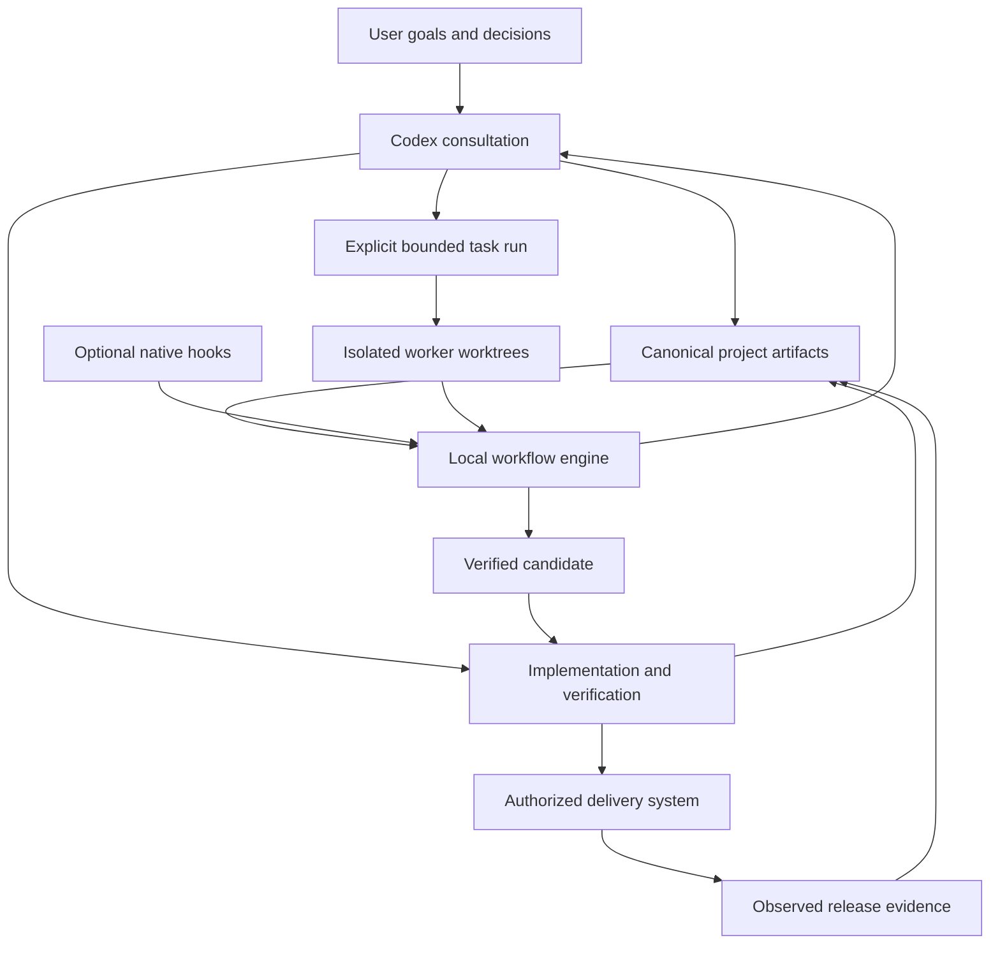

# Workflow architecture

Codex conducts consultation and semantic engineering work. Local code maintains deterministic workflow checks, prepares source-bound review requests and coordinates explicitly selected task runs. The project's existing delivery system performs authorized releases. These boundaries make failures diagnosable and keep authority traceable.

## Runtime boundary

Arrows describe information and work, not a new permission grant. An unresolved consequential decision may pause a phase; already authorized work should continue.

## Put deterministic behavior in code

| Code owns | Codex owns |
| --- | --- |
| Safe installation, path and collision checks | Interpreting existing project authority and resolving conflicting instructions |
| Active-work lookup and source references | Deciding the right scope and route from the user's intent |
| Work schema and phase-transition preconditions | Conducting the adaptive interview and making recommendations |
| Task ID, dependency, coverage and cycle checks | Judging whether requirements, designs and tests are sufficient |
| EARS form, response schema and property mapping checks | Finding contradictions and deriving useful correctness properties |
| Review/evidence snapshots and freshness checks | Actually reviewing artifacts, running checks and interpreting observations |
| Eligible-task projection | Implementing the change and choosing meaningful additional verification |
| Dependency waves, write-scope validation, candidate checks and bounded process execution | Choosing meaningful scopes/commands and reviewing actual results |
| Bounded hook input and output | Reporting results accurately and deciding when a real blocker needs the user |

A compiled language would not remove the model's judgment obligations. The current standard-library Python implementation keeps the installation small and inspectable. Its CLI and versioned JSON boundary can be retained if distribution or runtime needs later justify another implementation language.

## One authority for each kind of state

Canonical brief and work documents contain facts, answers, requirements and decisions. `tasks.md` contains task completion. `work.json` indexes sources, the selected phase, questions, revision-bound review references and evidence. `.codex/workflow.json` selects the active work directory; it is project-owned data, not a native Codex workflow API.

The engine parses the documented task/check contract, verifies referenced identities and reports contradictions. It does not maintain another mutable task checklist. `analysis.json` and `properties.json` retain source-bound semantic review history. Run records retain attempts and outcomes, while task completion stays in Markdown. A hash detects changed files; it cannot authenticate the actor or prove that a stated observation is truthful.

See [the CLI contract](reference/workflow-tooling.md) for exact schema, routes, normalization and limits. Changes to meaningful task scope invalidate relevant evidence; changing a completion checkbox alone must not invalidate the task-plan review it implements.

## Context and consultation

The active context exposes known facts, answered questions, next consequential questions, review state and eligible tasks. Its next action follows the selected phase and required analysis/property gates. Source references let Codex verify the content without rereading the whole repository. The interview starts from available knowledge; decisions accumulate in durable artifacts instead of relying on conversation memory.

`AGENTS.md` provides the entry procedure. Optional `SessionStart` and `UserPromptSubmit` hooks refresh context; `Stop` reports record errors without generating an automatic continuation loop. Hook trust, host support and actual loading are separate from fixture correctness. [Native integration](reference/native-hooks.md)

## Greenfield and brownfield

The installer copies a deliberate reusable layer into `.aws-workflow/`, supplies fresh application context where necessary, and appends a bounded instruction block. It excludes framework work/evidence and leaves client configuration and existing active work intact. Brownfield adoption maps established authority before introducing structured work. File preservation is tested by code; semantic compatibility still needs repository assessment. [Adoption contract](reference/bootstrap.md)

## Execution and recovery limits

Ordinary implementation can proceed in the current Codex session. An optional `run --execute` uses the supported native exec interface for a foreground bounded run. It requires a clean committed project and explicit execution policy. Independent tasks use separate Git worktrees, overlapping scopes serialize, and declared checks verify a separate candidate. `run-apply` integrates against the expected original state; unexpected hook effects remain visible and require review. It does not enable a background scheduler or deploy AWS infrastructure by default.

Resuming a session reloads durable work records and reevaluates freshness. `sync` previews affected conclusions, completion and the earliest review boundary; applying the exact preview retains history and unaffected valid work. It does not rewrite product decisions or report a new test pass.

The task controller records intent before dispatch, bounds attempts/time and retains uncertain outcomes. Native process control targets POSIX environments. It cannot guarantee exactly-once external effects, enforce IAM with file scopes, or infer monetary usage from a timeout. An uncertain external operation requires actual inspection within authority. Native client behavior and AWS outcomes remain separate observations. [Execution reference](reference/task-execution.md) · [Integration contracts](adapter-contracts.md)
