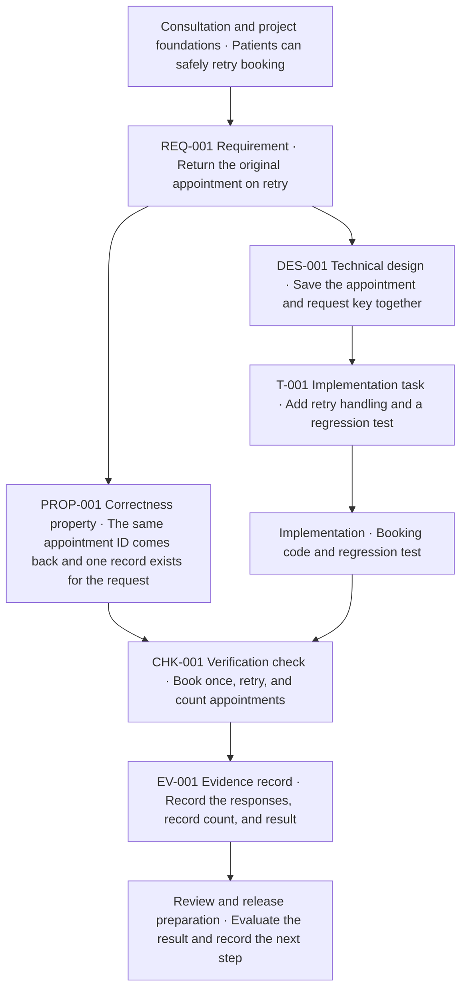

# Deliver the first feature

The [feature procedure](../workflows/feature.md) is the operating contract. Codex owns the investigation and engineering recommendations; the user resolves product or authority decisions that cannot be established from existing evidence.

## Choose a route and preserve context

| Starting point | Route | Review sequence |
| --- | --- | --- |
| New user behavior drives the solution | Requirements-First | Requirements, design, then task plan. |
| Established architecture or a supplied design constrains the change | Design-First | Design, derived requirements checked against the goal, then task plan. |
| Bounded scope is understood after initial clarification | Quick Spec | Draft all three documents, then review the combined scope. |
| Existing behavior is defective | Bugfix | Defect/expected/preserved contract, fix design, then task plan. |
| A bounded change needs exploration before a decision | Plan-led | Concise plan with outcomes, affected surface, checks, and remaining decisions. |

The selected route is recorded with the work. It does not automatically change the Codex application's mode. The CLI's `plan` route ends with a planning result, `planned`; link subsequent implementation work when it needs tracked execution stages. Respect any actual read-only mode and persist at an authorized write handoff.

Read the mapped project brief, existing answers, relevant code, and handoff before opening a new item. A work directory under `specs/` contains substantive Markdown plus `work.json` indexing context, questions, artifact identities, review decisions, and evidence. Dependencies and task completion remain authoritative in `tasks.md`.

## Build the specification through consultation

Use the [consultation interview](06-consultation-interview.md). Ask one to three material questions per round, save answers, and refine drafts as you go. Do not ask which service or database to use when requirements and research support an engineering recommendation. Label reversible planning assumptions and expose decisions with real business consequences.

Start from the [requirements](../templates/requirements.md), [design](../templates/design.md), and [tasks](../templates/tasks.md) templates, or the [bugfix template](../templates/bugfix.md). Correct relative links when copying. The CLI creates an initial skeleton; it does not supply missing product policy or prove that a design is sound.

Requirements identify the actor, condition, observable outcome, relevant limit, failure behavior, and preserved contracts. Analyze the whole set for contradictions, undefined terms, incompatible limits, unstated prerequisites, and concurrent or partial-failure cases. Resolve technical findings from evidence; ask the user only about the remaining material decisions.

New CLI work uses explicit EARS statements. Run `analyze` to obtain the current source-bound review request, perform the semantic review, and save its response and supporting notes. Record that actual response with `analyze --record <project-relative-response.json>`. This record is required before contract acceptance; it does not itself approve the contract. Syntax checking alone cannot establish correctness.

Design explains components, contracts, data, errors, security boundaries, operating consequences, cost assumptions, and verification. Link established decisions and research material AWS claims through [official guidance](02-aws-guidance-and-access.md). For brownfield work, specify the smallest changed surface and preserve existing architecture and ownership.

Use `properties` to prepare the correctness-property request after requirements and design exist. Derive observable statements, preconditions and suitable verification strategies, then record the actual response. During design, task/check IDs can be proposed; before task acceptance they must resolve to the real task graph. These commands prepare and validate review records; Codex writes the actual test implementation in the selected tasks. [Operation reference](../docs/reference/specification-operations.md)

## Perform and record actual phase reviews

Follow the route's review sequence. A review inspects the current artifact and records findings, outcome, reviewer, and the decision or delegation supporting continuation. Standard routes retain their phase reviews; Quick Spec uses one combined review after upfront clarification and drafting all three artifacts.

Present the material scope and tradeoffs in plain language. When an actual decision is needed, ask about that concrete result. When existing authorization delegates the choice, perform the review and continue under that authority. Do not turn every phase into a new permission request. Do not translate silence, generated text, or author self-review into user acceptance or an independent review.

The local `review` command records an actual decision and binds it to the current artifacts. Its `accepted` outcome may record a user decision or a review under real delegated authority; it does not authenticate either. Write the review notes first, then record their source with the CLI. A substantive change can make the recorded snapshot stale and require reconciliation. Task-plan snapshots exclude routine completion, activity, and evidence updates so recording progress does not itself invalidate the plan.

## Generate an implementable task graph

Every task needs a bounded outcome, explicit requirement/design links, prerequisites, scope, acceptance, checks, and evidence obligations. Preserve the template's task heading, checkbox, and labeled fields. List each ID explicitly rather than using "all" or a range. Check that prerequisites exist, no dependency cycle exists, and every required requirement is covered.

Optional techniques and optional product scope are distinct from required outcomes. Property-based testing may be useful for an invariant, but example, integration, contract, or operational checks may be more appropriate. A required behavior still needs evidence whichever technique is chosen.

Run read-only local checks from the adopted project root:

```bash
python3 .aws-workflow/scripts/workflow.py --root . context
python3 .aws-workflow/scripts/workflow.py --root . status
python3 .aws-workflow/scripts/workflow.py --root . validate
```

These inspect the recorded workflow, task graph, coverage, and phase evidence. They do not independently establish requirement quality, real approval, test success, or AWS behavior. The separate repository checker validates local Markdown links and required structure only. See [tool usage](../scripts/README.md) for exact supported commands.

## Follow an appointment-booking change

Start with the outcome you want. Suppose patients can book appointments online. A patient submits a booking, the system saves it, and the response gets lost. The patient retries the same request and should get back the original appointment. The client sends a request key, a value it reuses across retries of the same booking attempt. During consultation, capture the user need in the project foundations. Then turn the retry behavior into a small specification with a decision about how to build it and a plan to verify it.


This is a worked illustration. The specification, appointment ID, and result below are examples.


The identifiers are stable labels within the work item. In the table, `<work-id>` is `0001-booking-retries`. All paths start at the application root.

| Artifact and location | Question it answers | Appointment-booking example and connection |
| --- | --- | --- |
| **Requirement (REQ)** in `specs/<work-id>/requirements.md` | **What should the system do?** A requirement states behavior someone can observe. | `REQ-001` says that after a successful booking, retrying with the same patient, request key, and booking details returns the original appointment. This behavior guides the design and property. |
| **Technical design (DES)** in `specs/<work-id>/design.md` | **How will the system deliver that behavior?** The design explains the approach and important choices. | `DES-001` saves the appointment and the patient-scoped request key together in one transaction, so both records are saved or neither is. On retry, the code finds the saved appointment. This design guides the implementation task. |
| **Correctness property (PROP)** in `specs/<work-id>/properties.json` | **What rule should always hold under the stated conditions?** A property gives you something concrete to verify. | `PROP-001` says that when a patient retries a successful request with the same key and details, both responses identify the same appointment and exactly one appointment is stored for that request. This rule tells the check what to assert. |
| **Implementation task (T)** in `specs/<work-id>/tasks.md` | **What change should we make?** A task describes a bounded piece of work and how to verify it. | `T-001` implements the lookup and replay behavior in the booking code and adds a test. It links to the requirement, design, and check. The implementation lives in the application's source and test files, typically under `src/` and `tests/`. |
| **Verification check (CHK)** in the verification matrix in `specs/<work-id>/tasks.md` | **What steps will we run, and what result do we expect?** A check gives a repeatable procedure and a pass condition. | `CHK-001` starts with no appointment for the request, submits it once, then retries with the same patient, key, and details. It compares the returned appointment IDs and queries storage for the count. Pass means both IDs match and the count is one. |
| **Evidence record (EV)** with a receipt under `evidence/<work-id>/` and an entry in `specs/<work-id>/work.json` | **What actually happened when we ran the check?** Evidence records the observed result and the conditions of the run. | An **illustrative** `EV-001` for `CHK-001` might record “Both responses returned `APT-104`. Stored appointment count was 1.” A real receipt includes the command or procedure, candidate revision, inputs, environment, observation time, and actual result. |

The requirement and property describe intended behavior. The design explains how to achieve it, and the source code implements it. The check defines how to verify the behavior. Evidence records what happened during a specific run, including unexpected results. Inspect the evidence before completing the task or using the result in a release decision.

## Implement, review, and finish at the correct boundary

Read the relevant contract before each task. Work in small changes and parallelize only separable scopes with a clear integration owner. Record actual results against the candidate revision, configuration, and environment. A local patch needs a patch identity in addition to its base commit. Shared files and shared conversation history do not make a review independent.

Continue directly in the current session, or prepare the explicit execution policy and inspect `run-plan`. An authorized `run --execute` uses isolated worker/candidate worktrees and actual declared checks. Inspect `run-status` and the candidate before `run-apply`; uncertain outcomes need inspection rather than replay. The [execution reference](../docs/reference/task-execution.md) covers setup, bounds, trusted commands and application.

Use [Reconcile](../workflows/reconcile.md) when answers, design, implementation, or environment assumptions materially change. `sync` previews affected conclusions and completion; apply its current fingerprint after inspecting the change. Refresh actual semantic reviews and verification while preserving useful work whose acceptance remains valid.

Use [Review](../workflows/review.md) on the integrated candidate and resolve blocking findings. Finish with achieved behavior and its evidence, plus explicit pending obligations. If deployment is authorized, continue through [maintenance and release](04-maintain-and-release.md). A reviewed specification, completed implementation, release-ready artifact, successful deployment, and verified user outcome are separate states.

See [consultation examples](../examples/consultation/README.md) for the discussion that creates a spec, and [booking retries](../examples/booking-retries/README.md) for acceptance traceability.
