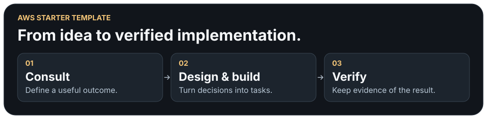
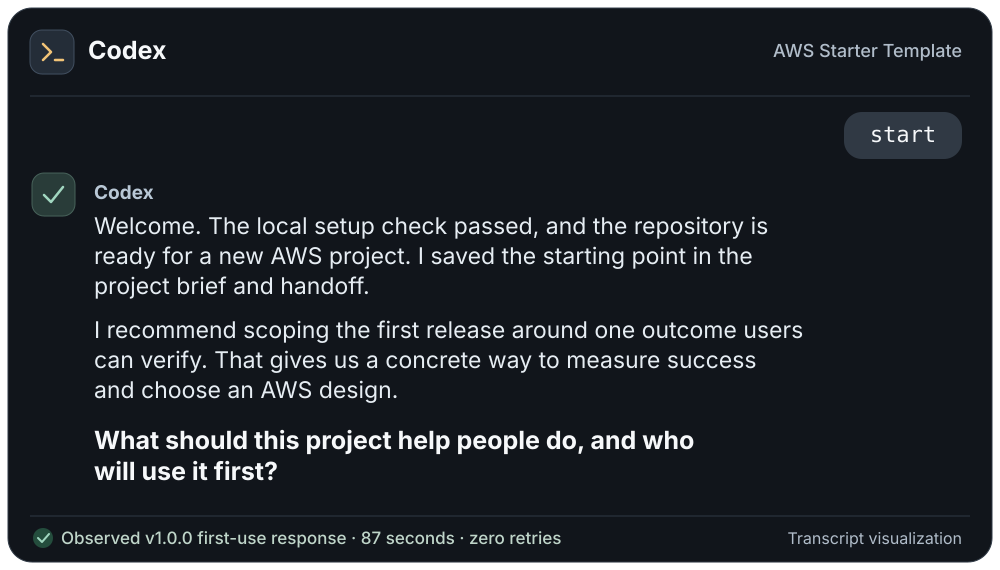
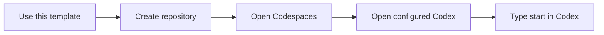
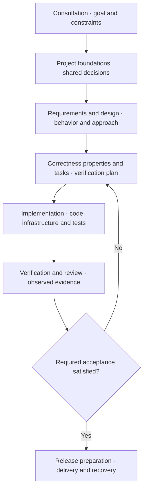
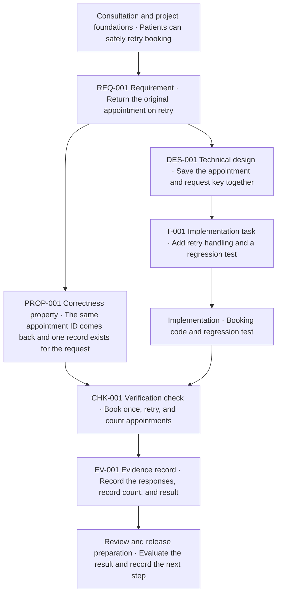
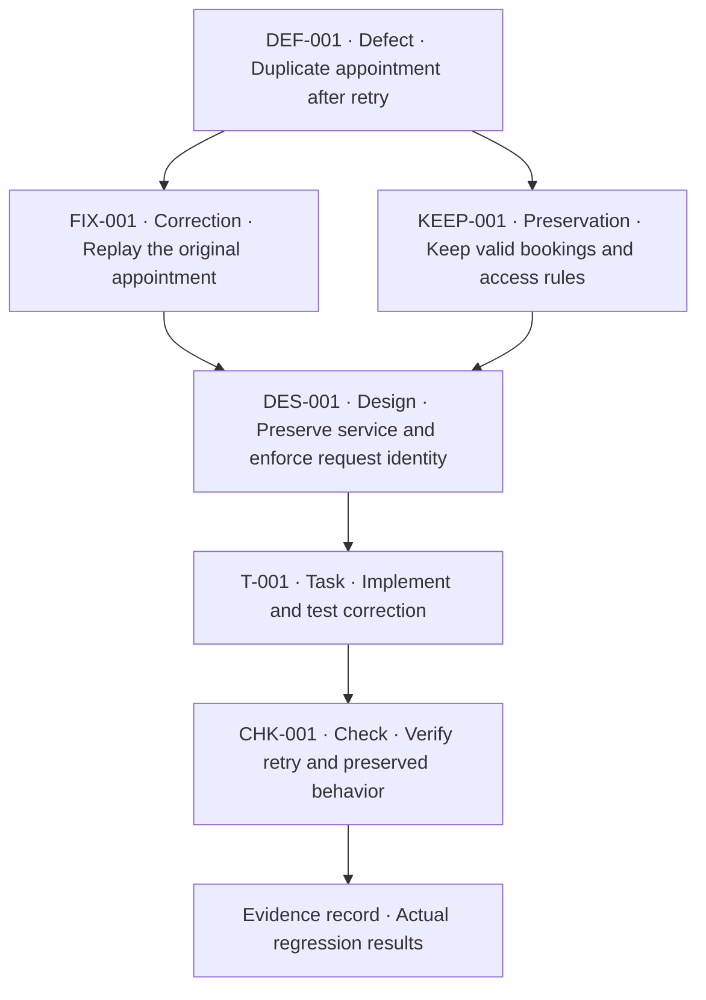
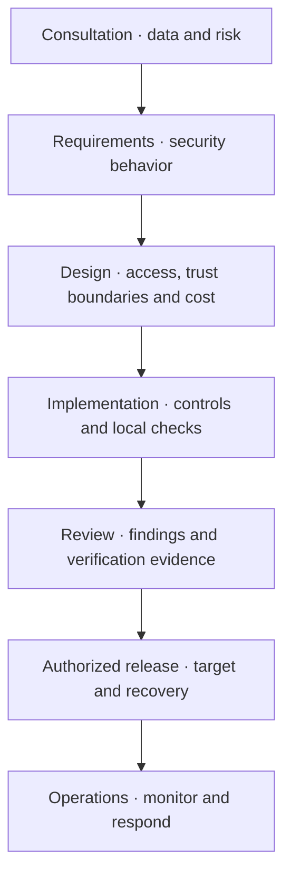
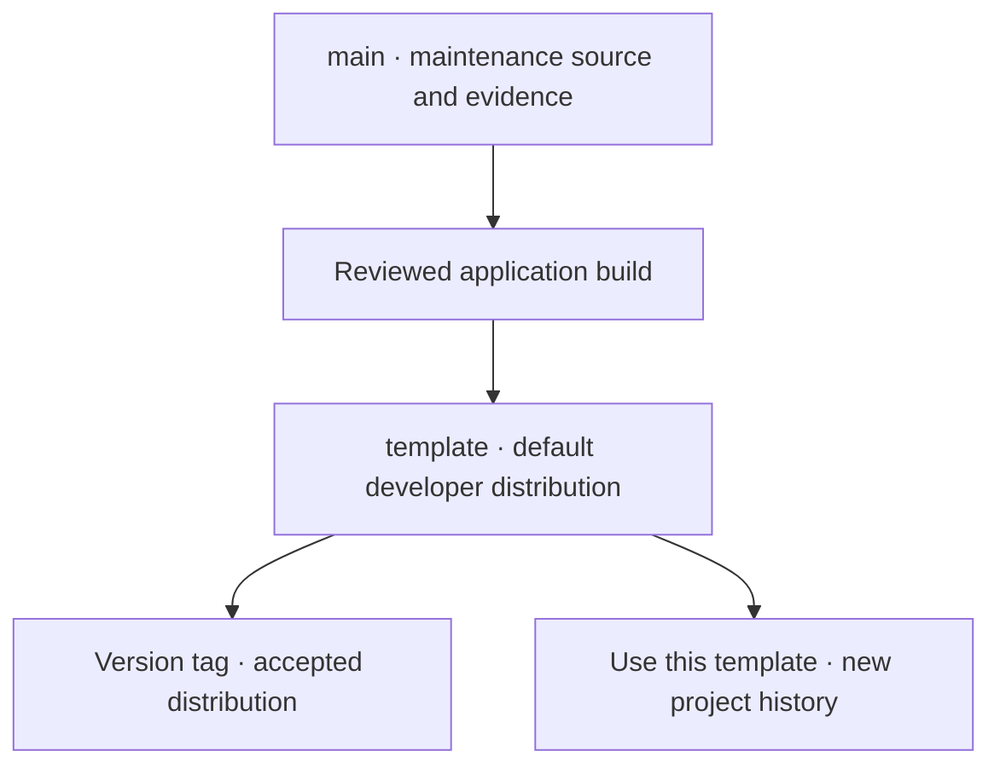

# AWS Starter Template

**From idea to verified implementation.**

A specification-driven AWS engineering framework powered by Codex, for developers building new applications or improving existing ones.



## Why it exists

Writing code is only one part of engineering. When requirements, design decisions and test results live in scattered conversations, it is difficult to resume work, understand why a change was made or know whether it is complete.

AWS Starter Template gives you an organized repository and a repeatable engineering process. Start with a conversation rather than a predetermined architecture. Codex investigates requirements, recommends an approach and preserves decisions in your project's own files. The local Python workflow checks declared relationships, prerequisites, reviews and evidence without replacing engineering judgment.

## Key capabilities

- **Adaptive consultation and persistent context.** Codex uses existing facts, asks about consequential decisions, and saves your answers, open questions, and next steps in project records.
- **Specification-driven development.** Project foundations establish shared constraints. A scoped specification connects observable requirements, design, correctness properties, tasks, and checks.
- **Local workflow checks.** The workflow CLI checks record structure, task dependencies, review state, and evidence freshness. Use the current Codex session for ordinary implementation or an explicitly authorized, bounded native run when it suits the work.
- **Security and AWS guidance throughout delivery.** Consider access, data, costs, recovery, and operational risks during design and review. Record evidence that matches each claim.

## See it in action

You do not need to arrive with a complete specification. Begin with `start` and describe what you want to build. Codex asks one to three material questions at a time, informed by your answers and existing project context.



*Transcript visualization, not a captured screenshot. This final response was observed in the v1.0.0 first-use smoke: one completed turn, 87 seconds, zero retries. Future wording and timing vary.*

<details>
<summary>Read the observed response as text</summary>

**Developer (in Codex):**

```text
start
```

**Codex:**

> Welcome. The local setup check passed, and the repository is ready for a new AWS project. I saved the starting point in the [project brief](project/brief.md) and [handoff](delivery/current-handoff.md).
>
> I recommend scoping the first release around one outcome users can verify. That gives us a concrete way to measure success and choose an AWS design.
>
> **What should this project help people do, and who will use it first?**

[Observed first-use receipt](https://github.com/Levi-Breedlove/starter-template/blob/9f7b949d55dea856b15712d5af47733719eecee1/evidence/0004-developer-workflow/native-first-use.json)

</details>

Your answers shape the scope. Codex investigates technical options, explains tradeoffs and saves settled decisions. On return, use `start` or `resume` to continue from the recorded context.

## Quick start in Codespaces

1. Open the starter template on GitHub and choose **Use this template → Create a new repository**. Leave **Include all branches** clear to copy the application starter. Choose visibility appropriate for your project.
2. In the new repository, choose **Code → Codespaces** and create or open a codespace.
3. Open the configured Codex client at the application root. The repository already includes the workflow and initial project documents.
4. Type **`start`**. Tell Codex what you want to build and who needs it. It will inspect the project context, ask about material decisions, and record the next step.

[First-use guide](.aws-workflow/guide/00-quickstart.md) · [Codespaces setup](.aws-workflow/guide/07-codespaces.md)



**Terminal versus conversation.** From your new application root in a regular Codespaces terminal, confirm the required tools:

```sh
git --version
python3 --version
```

If you use the configured Codex CLI, check and open it from the same root:

```sh
codex --version
codex
```

Enter the following in the Codex conversation, not the shell:

```text
start
```

Expect local inspection, a welcome and a focused question or continuation of saved work. The brief and handoff retain the next step. The example above is an actual observed response. Use your client's supported installation and sign-in procedure if configuration is missing.

## Prerequisites and optional tools

| Capability | Setup |
| --- | --- |
| Local workflow | Git and Python 3.10 or newer. The workflow tools use the Python standard library. |
| Codex consultation | A configured Codex client that can read the application and run permitted local commands. Use the client's supported sign-in and permissions. |
| Official AWS guidance | Use public AWS documentation or discover relevant Agent Toolkit for AWS guidance through AWS Core when available. Reuse official plugins already installed on your Codex surface. |
| Local AWS integration tests | Consider AWS Emulator if it supports the API operations your tests need. Follow the setup guide for your platform and verify each operation you rely on. |
| Native task execution | Optional bounded worker runs require a configured Codex CLI and a supported launch environment. Check client state and the execution policy from the shell that would launch the worker. |
| Authenticated AWS operations | Use an explicitly authorized AWS identity, account, environment, action scope, and cost limit. |

From the application root, run the read-only setup check when you want to confirm the package and context mappings:

```sh
python3 .aws-workflow/scripts/workflow.py --root . doctor
```

A fresh application can report readiness before you select work. On the observed clean v1.0.0 first use, the setup check reported these selected fields (the full output contains other diagnostics):

```json
{
  "status": "ready",
  "layout": "adopted",
  "active_work": null
}
```

A missing active specification is normal at this stage. Address actual reported setup issues before proceeding. Record plugin availability and observed capabilities in the environment record. [AWS guidance and access](.aws-workflow/guide/02-aws-guidance-and-access.md) · [AWS Emulator](.aws-workflow/guide/08-aws-emulator.md) · [Bounded task execution](.aws-workflow/docs/reference/task-execution.md)

## How the engineering workflow works

Consultation develops the five project foundations: product brief, system requirements, technology standards, repository structure and architecture. A feature or defect specification describes a bounded change against those foundations.



This is a common scoped delivery, not a mandatory sequence for every edit. Requirements-first, design-first, Quick Spec, bugfix and planning routes have their own review boundaries. Deployment requires separate applicable authorization. [Workflow contract](.aws-workflow/docs/reference/workflow-contract.md)

## Learn specification-driven development

Start with the outcome you want. Suppose patients can book appointments online. A patient submits a booking, the system saves it, and the response gets lost. The patient retries the same request and should get back the original appointment. The client sends a request key, a value it reuses across retries of the same booking attempt. During consultation, capture the user need in the project foundations. Then turn the retry behavior into a small specification with a decision about how to build it and a plan to verify it.

### Follow one appointment-booking change

This is a worked illustration. The specification, appointment ID, and result below are examples. The [verification section](#verification-and-limitations) covers actual template checks.



The identifiers are stable labels within the work item. In the table, `<work-id>` is `0001-booking-retries`. All paths start at the application root.

| Artifact and location | Question it answers | Appointment-booking example and connection |
| --- | --- | --- |
| **Requirement (REQ)** in `specs/<work-id>/requirements.md` | **What should the system do?** A requirement states behavior someone can observe. | `REQ-001` says that after a successful booking, retrying with the same patient, request key, and booking details returns the original appointment. This behavior guides the design and property. |
| **Technical design (DES)** in `specs/<work-id>/design.md` | **How will the system deliver that behavior?** The design explains the approach and important choices. | `DES-001` saves the appointment and the patient-scoped request key together in one transaction, so both records are saved or neither is. On retry, the code finds the saved appointment. This design guides the implementation task. |
| **Correctness property (PROP)** in `specs/<work-id>/properties.json` | **What rule should always hold under the stated conditions?** A property gives you something concrete to verify. | `PROP-001` says that when a patient retries a successful request with the same key and details, both responses identify the same appointment and exactly one appointment is stored for that request. This rule tells the check what to assert. |
| **Implementation task (T)** in `specs/<work-id>/tasks.md` | **What change should we make?** A task describes a bounded piece of work and how to verify it. | `T-001` implements the lookup and replay behavior in the booking code and adds a test. It links to the requirement, design, and check. The implementation lives in the application's source and test files, typically under `src/` and `tests/`. |
| **Verification check (CHK)** in the verification matrix in `specs/<work-id>/tasks.md` | **What steps will we run, and what result do we expect?** A check gives a repeatable procedure and a pass condition. | `CHK-001` starts with no appointment for the request, submits it once, then retries with the same patient, key, and details. It compares the returned appointment IDs and queries storage for the count. Pass means both IDs match and the count is one. |
| **Evidence record (EV)** with a receipt under `evidence/<work-id>/` and an entry in `specs/<work-id>/work.json` | **What actually happened when we ran the check?** Evidence records the observed result and the conditions of the run. | An **illustrative** `EV-001` for `CHK-001` might record “Both responses returned `APT-104`. Stored appointment count was 1.” A real receipt includes the command or procedure, candidate revision, inputs, environment, observation time, and actual result. |

The requirement and property describe intended behavior. The design explains how to achieve it, and the source code implements it. The check defines how to verify the behavior. Evidence records what happened during a specific run, including unexpected results. Inspect the evidence before completing the task or using the result in a release decision.

Requirements analysis in `analysis.json` records the review of the contract, including ambiguity and missing cases. The `work.json` record indexes the specification, reviews, and evidence. Across work items, cite the work ID or artifact path along with the identifier so readers can find the exact record.

Use the route that fits the change. Requirements and design can be reviewed in either order. A Quick Spec uses a combined review for a small, understood scope. Carry review findings into release preparation and operations, then save the next action in the handoff so work can resume with its context. [Specification operations](.aws-workflow/docs/reference/specification-operations.md) · [Workflow contract](.aws-workflow/docs/reference/workflow-contract.md) · [Maintenance and release](.aws-workflow/guide/04-maintain-and-release.md)

### When existing behavior breaks

If the patient's retry creates a second appointment instead of returning the first, a defect specification separates the problem, the correction, and the behavior that must remain intact. This is an illustration, not a reported defect in the starter.

| Identifier | Meaning | Example |
| --- | --- | --- |
| `DEF-001` — Defect | Observed problem | A retry creates a duplicate appointment. |
| `FIX-001` — Correction | Expected fixed behavior | The same patient, key and details return the original appointment. |
| `KEEP-001` — Preservation | Behavior that must not break | New valid bookings, access rules and validation still work. |



`bugfix.md` holds the defect, correction and preservation contracts. `design.md` and `tasks.md` connect the fix to implementation and checks. Reproduce the problem and inspect the evidence before declaring it fixed.

## Repository structure

This is the initial packaged layout. Git tracks the empty application areas through `.gitkeep` files.

```text
.
├── .aws-workflow/                Installed workflow and manifest
├── .github/
│   └── pull_request_template.md
├── .gitignore
├── AGENTS.md                     Project instructions
├── CHANGELOG.md
├── CONTRIBUTING.md
├── README.md
├── SECURITY.md
├── costs/                        Estimates and cost controls
├── delivery/
│   ├── current-handoff.md         Current scope and next step
│   └── environment-capabilities.md  Environment capability observations
├── docs/
│   ├── decisions/                 Architecture decision records
│   └── diagrams/                  Supporting diagrams
│       ├── starter-overview.svg   README product visual
│       └── starter-consultation.svg  README transcript visual
├── evidence/                     Recorded verification by work item
├── infrastructure/               Infrastructure code and ownership
├── project/
│   ├── adoption-report.md         Existing system assessment
│   ├── architecture.md           System design and trust boundaries
│   ├── brief.md                  Product goals, users, and scope
│   ├── requirements.md           System-wide requirements and constraints
│   ├── structure.md              Component ownership and naming conventions
│   └── tech.md                   Stack and engineering standards
├── runbooks/                     Deployment, recovery, and operations
├── security/                     Threat, access, and data decisions
├── specs/                        Scoped feature and defect work
├── src/                          Application source
└── tests/                        Application verification
```

<details>
<summary>Explore the installed engineering framework</summary>

```text
.aws-workflow/
├── README.md
├── manifest.json
├── costs/
├── delivery/
├── docs/
│   └── reference/
├── evaluations/
├── evidence/
├── examples/
├── guide/
├── infrastructure/
├── runbooks/
├── scripts/
├── security/
├── specs/
├── templates/
├── workflow_engine/
└── workflows/
```

Inside `.aws-workflow/`, `manifest.json` maps the application's canonical records. `scripts/` and `workflow_engine/` contain the local tools. `guide/`, `workflows/`, `docs/`, `templates/`, and `examples/` provide instructions and reference material. The installed package also includes guidance for areas such as costs, security, and operations. Keep your own project decisions, work, and evidence in the application's mapped locations. [Repository map](.aws-workflow/docs/repository-map.md) · [Project instructions](AGENTS.md)

</details>

The two starter SVGs are product documentation, not inherited application architecture or acceptance evidence.

The appointment-booking example below uses this illustrative set of work files. A new template project starts with an empty work area.

```text
specs/0001-booking-retries/
├── requirements.md
├── design.md
├── tasks.md
├── work.json
├── analysis.json
└── properties.json
evidence/0001-booking-retries/
└── same-key-retry.md
```

A bugfix uses `bugfix.md` for its defect, correction, and preserved behavior. The work plan and the verification actually performed determine which records to create. [First feature](.aws-workflow/guide/03-first-feature.md) · [Specification operations](.aws-workflow/docs/reference/specification-operations.md)

## Repository conventions

For new projects, use lowercase kebab-case for ordinary directories and Markdown, numbered work directories such as `0001-booking-retries`, and stable identifiers inside each work item. Follow the source language and tooling for source filenames. Record accepted project conventions and exceptions in the mapped structure document. [Canonical repository conventions](project/structure.md)

## Conversational shortcuts

Use natural language to describe the outcome, constraints, or change you want. These short prompts are convenient entry points:

| Prompt | What Codex does |
| --- | --- |
| `start` | Inspect setup and context, then begin or resume consultation. |
| `resume` | Reconcile the saved state and continue the next eligible authorized action. |
| `status` | Summarize project state, blockers, and the next step without writing files. |
| `feature` | Clarify new behavior and choose a suitable specification route. |
| `bugfix` | Establish what failed, what should happen, and what behavior to preserve. |
| `review` | Assess the selected work and its evidence. |
| `release` | Prepare delivery, verification, and recovery under existing controls. |

For example, enter this natural-language request in Codex:

> I want to build an appointment booking application. Help me understand the user journeys, recommend an AWS architecture, and prepare the first reviewed specification. Keep this scope to planning and local work I authorize.

Later, type `status` to inspect progress or `resume` to continue. Responses to all seven shortcuts depend on the actual project, not a predetermined script.

The current authorization governs every prompt. Account access, deployment, and additional native execution each require authority for that action. [Current handoff](delivery/current-handoff.md) · [Project instructions](AGENTS.md)

## Security and AWS development

Use the official Agent Toolkit for AWS when relevant capabilities are available. Public guidance and skill discovery can support development without AWS credentials. On a supported Codex CLI, inspect the existing marketplace in the terminal:

```sh
codex plugin marketplace list
```

Only if the official marketplace is missing and installation is authorized, add it:

```sh
codex plugin marketplace add aws/agent-toolkit-for-aws
```

Inspect `/plugins` in Codex and reuse installed official identities. Discover relevant skills through AWS Core using `search_documentation` with the `agent_skills` topic, then retrieve the exact returned skill identifier. These are tool operations, not shell commands. Follow the [official toolkit instructions](https://github.com/aws/agent-toolkit-for-aws#codex) and [AWS setup guide](.aws-workflow/guide/02-aws-guidance-and-access.md). Client availability varies. AWS Emulator is optional. Setup does not authorize account operations.


During consultation and design, identify sensitive data, trust boundaries, permissions, and cost drivers. Use public guidance, synthetic data, and local tests to work without AWS credentials. If emulation fits, isolate it on a local endpoint with emulator-specific credentials and TLS verification.

For authenticated work, establish least-privilege access, a specific target, observable cost boundaries, and a recovery path. Use authorized live checks for claims that depend on AWS permissions, service behavior, or deployment. Keep credentials and customer data out of prompts, source, and evidence. [AWS guidance and access](.aws-workflow/guide/02-aws-guidance-and-access.md) · [Delivery controls](.aws-workflow/docs/reference/aws-delivery.md) · [Security guidance](.aws-workflow/security/README.md)

<details>
<summary>Security throughout the lifecycle</summary>



The scaffold provides guidance and contracts, not a preconfigured security pipeline or proof that a deployed control works. Define and verify the controls appropriate to the workload.

</details>

## Existing application adoption

From a separate checkout of the starter, set `app` to the path of the existing repository. Preview the changes first:

```sh
app=/path/to/existing-app
python3 .aws-workflow/scripts/bootstrap.py --source .aws-workflow --target "$app" --mode brownfield
```

Review proposed additions, mapped records, and preserved files. Use options such as `--structure` for an existing conventions file and `--authority` for an established task or infrastructure authority. When satisfied with the preview, run the corresponding apply from the same starter checkout and shell, retaining any reviewed mapping options:

```sh
python3 .aws-workflow/scripts/bootstrap.py --source .aws-workflow --target "$app" --mode brownfield --apply
```

Then open the existing application's root in Codex and type `start`.

The additive install preserves existing instructions, project records, architecture, and task and delivery authority. Review the adoption report with Codex before proposing changes to the existing system. [Adoption, mappings, and upgrades](.aws-workflow/docs/reference/bootstrap.md)

## Project management

Use the current specification's task record as the completion authority when the project adopts that workflow. In an existing application, identify the established task authority first. Link tasks and evidence across systems, and decide deliberately which system owns each status update before integrating an external tracker such as Linear. Tracker setup and synchronization require an explicit project integration. [Task records](.aws-workflow/specs/README.md)

## Built with

- **Codex:** consultation, research, engineering judgment and authorized implementation.
- **Python standard library:** local workflow, structural checks and optional bounded execution.
- **Git and GitHub:** history, templates, review and versioned distribution.
- **Official Agent Toolkit for AWS:** relevant guidance and, only when authorized, applicable cloud operations.

## Verification and limitations

From the application root, run the packaged local documentation and structure checker:

```sh
python3 .aws-workflow/scripts/check_repository.py --root .
```

The checker reports a pass or actionable issues for required files and local links. It does not establish semantic correctness, application test results or live AWS behavior. Once work is selected, the installed `status` and `validate` commands inspect recorded specification state. [Tooling reference](.aws-workflow/docs/reference/workflow-tooling.md)

- **v1.0.0 acceptance.** The maintenance release recorded 207 passing offline regressions. The native pilot accepted all eight stages across 12 launches on frozen workflow source `64875ee`. A separate first-use `start` smoke on distribution `895a9b9` completed in Codespaces in 87 seconds with zero retries.
- **v1.0.1 earlier documentation candidate.** On `eb9e4ba`, 207 offline regressions and seven adoption scenarios passed. The appointment-retry Mermaid graph was parsed and its labels and connections checked. [Earlier candidate evidence](https://github.com/Levi-Breedlove/starter-template/blob/2f2e3b636f10a38190ebaa3103c88e75b7944ddb/evidence/0005-repository-documentation/walkthrough-review.md)
- **Visual review revision.** The product graphics and revised README are prepared for review. Fresh package builds, affected regression and traceability checks, and browser rendering must be verified before promotion. Historical checks above are not a test run on this revision. Optional AWS Emulator runtime and live AWS behavior remain unverified.

Codespaces is the verified development environment. Local use on Linux, macOS, or WSL depends on the installed tools and client. Confirm optional native and AWS capabilities on the execution surface your project uses. [Environment checks](.aws-workflow/guide/07-codespaces.md) · [Release notes](CHANGELOG.md)

## Versioning and maintenance

In the starter repository, `main` contains maintenance source, specifications, and acceptance evidence. The default `template` branch contains the distributable application. Version tags identify accepted distribution commits. Each repository created from the template has its own history. Adopt a later version through the reviewed upgrade procedure.



[Changelog and upgrade notes](CHANGELOG.md) · [Contribution guidance](CONTRIBUTING.md) · [Private security reporting](SECURITY.md)
