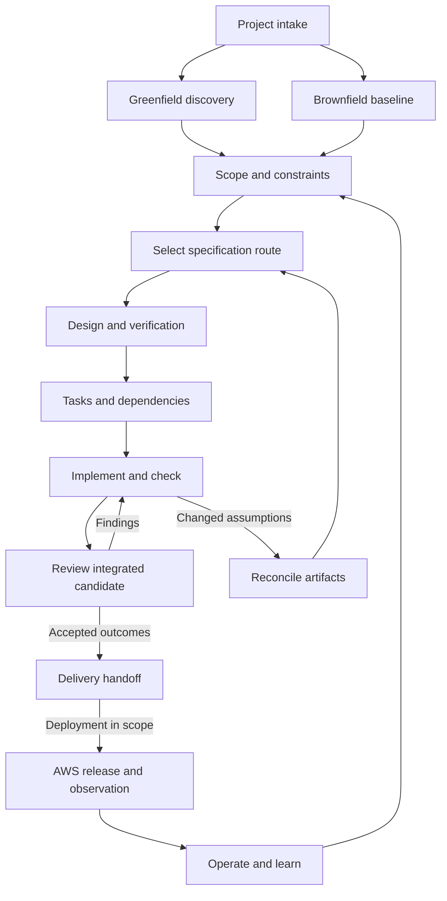
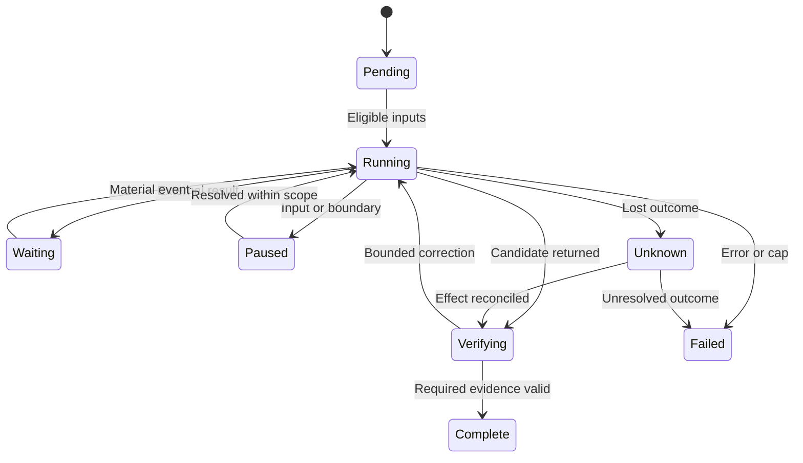

# Workflow architecture

**State:** Selected structure for this research/bootstrap delivery; deeper adapters are proposed and unimplemented. This is an original Codex design informed by the [official research](research/README.md), not a claim about private product internals or a replacement AWS application architecture.

## 1. Preserve the behavior behind the interface

The useful Kiro pattern couples project context, a specification, an execution process, and feedback. The three specification files are only one part. Current Kiro documentation also describes hooks, isolated workflow steps, explicit handoffs, bounded loops, external waits, and recovery. The [capability reference](reference/kiro-capabilities.md) records documented behavior and surface limits.

The Codex adaptation has five responsibilities:

| Responsibility | Repository implementation now | Deeper implementation boundary |
| --- | --- | --- |
| Understand the project | Brief, source inspection, adoption report, concise AGENTS routing | Context selection and source-backed refresh. |
| Define the change | Requirements/bugfix, design, tasks, decisions | Deterministic traceability and impact checks. |
| Carry out the work | Explicit procedures and native tools available in the session | Task scheduling, isolated workers, bounded review loops. |
| Establish the result | Verification matrix, evidence, review, final acceptance | Evidence binding and stale-result detection. |
| Deliver and continue | Release record, runbooks, handoff | Approved pipeline/event integration and durable resume. |

The official AWS toolkit remains the AWS guidance/operations adapter. The workload retains its selected IaC and delivery system. Neither becomes the repository's workflow state store.

## 2. One lifecycle, two entry paths

This diagram is the repository's proposed process. It does not assert that each transition is a native Kiro or Codex API call. Existing authorization allows continuous progress through transitions; an unresolved material decision or operation outside scope is the reason to pause.

## 3. Context and authority

The project brief owns purpose and constraints. An adoption report owns observed existing-system facts and known unknowns. Requirements own observable behavior; design owns the chosen technical explanation; tasks own work completion. Decisions record consequential choices. Evidence records observations about identified inputs. The handoff is a navigation and continuation summary, never another backlog.

Keep the root instruction file short enough to read routinely. Load a procedure and relevant technical references when needed. Preserve established subsystem instructions. A future context adapter should select documents by task scope and provenance; it should report conflicting instructions rather than silently choose a convenient architecture.

When adopting this in an existing project, map these responsibilities to existing files and tracker authority first. File paths are defaults, not a mandate to relocate code or duplicate requirements in a second system. See [the repository map](repository-map.md).

## 4. Specification routes and transition evidence

| Route | Entry evidence | Work order | Exit condition |
| --- | --- | --- | --- |
| Requirements-First | User outcome and constraints | Requirements critique, design, tasks | Behavior is testable and feasible within the design. |
| Design-First | Accepted technical constraints or a proposed technical change | Design, derived requirements, coverage review, tasks | User needs and preservation requirements remain represented. |
| Quick Spec | Small bounded scope with material questions resolved | Draft the three files together | One coherent reviewed scope, without arbitrary per-file pauses. |
| Bugfix | Reproduction/current behavior | Expected and preserved behavior, diagnosis, design, tasks | Fix checks and preservation checks are both identified. |
| Plan-led/direct | Limited uncertainty and impact | Explore as needed, small plan, edit, verify | A proportionate evidence record supports the actual change. |

Critique requirements for ambiguity, contradictory thresholds, assumptions, missing error cases, and concurrency. Use properties for invariants where they help. Property-based tests complement examples and integration tests; they do not prove external IAM, service configuration, or database semantics.

## 5. Execution and independent review

A task becomes eligible when its dependencies have valid outcomes, required inputs exist, and its action is within the project scope. Assign one writer for a shared artifact or isolate changes into separate worktrees. Parallel work earns its complexity only when its scopes can be joined and checked coherently.

The worker returns a candidate and observations. The integration owner checks the combined candidate against the specification. A fresh reviewer receives the contract, candidate, surrounding source, and evidence; it is not asked to inherit the author's reasoning or confirm an expected conclusion. Review can find a problem, find no problem within a stated scope, or remain incomplete. A reviewer failure is not a pass.

Final validation checks the accepted requirements and preserved behavior. A task checkbox, model completion event, zero exit code, or passing subset of tests is insufficient by itself. Each result must be interpreted against the check's purpose and environment.

## 6. Change and feedback loops

Two loops serve different purposes. The implementation loop fixes a candidate within the accepted contract. The reconciliation loop changes the contract when new information warrants it, then updates design, tasks, and affected verification. Keep that distinction visible so requirements do not quietly shrink around a flawed implementation.

PR feedback enters the same process. Classify each finding against the work's scope and authority, address accepted feedback, test the changed candidate, and obtain applicable review. CI and review results must belong to the current candidate. A historical green check cannot establish a new head's readiness.

Record finite limits for any automated loops before enabling them. Preserve attempt counts and remaining limits across resume. On repeated identical failure, diagnose the underlying problem or surface a concrete blocker instead of spending indefinitely.

## 7. Events and automation

Use deterministic scripts for deterministic questions: path validity, schema validity, missing required links, changed-file discovery, test execution, and evidence identity checks. Use agent reasoning for consultation, design, diagnosis, and review. Events may request those operations; they do not grant authority to perform them.

Current Codex hooks can provide useful lifecycle entry points, but their event and handler model differs from Kiro's. The [adapter contracts](adapter-contracts.md) define an explicit mapping. Spec-task boundaries belong to a task controller when the client lacks a native equivalent. An active hook must be reviewed/trusted through the supported client mechanism and tested before being described as installed automation.

## 8. Durable continuation

The conversational path uses the current handoff and actual repository evidence to resume. The planned controller adds durable run and attempt records. These execution records track what happened; they do not replace the canonical task list or create a second status authority.

These are proposed internal states, not copied product status names. Cancellation and terminal-stop rules must prevent new work while preserving already observed effects. A retry first examines partial changes or external operation receipts. It does not automatically undo edits, repeat deployments, or reset limits.

## 9. AWS delivery and operations

Public consultation uses official guidance without account access. Repository implementation produces a concrete candidate. Authorized assessment or preview observes a named environment within limits. Authorized deployment applies the selected artifact and configuration through the real delivery system. Operational verification observes whether the service meets its acceptance conditions.

Connect requirements to operational evidence where relevant: access boundaries, retention, retry behavior, alerting, recovery, latency, availability, and cost assumptions. Prefer a traceable artifact/configuration identity across environments over a verbal statement that the same code was deployed. Recovery must account for data and infrastructure transitions, not only application code.

Brownfield discovery records drift and ownership uncertainty rather than normalizing the live estate by default. Greenfield design includes operating and teardown requirements before creating resources. Specific service designs belong to the adopting project; this framework does not impose one.

## 10. Scope of parity

The bootstrap aims at reproducible engineering behavior, not a pixel-for-pixel Kiro IDE, a mobile client, an ACP implementation, or a copy of Crew. Those surfaces have their own capabilities and operating models. The [runtime research](research/runtime-parity.md) separates them.

Immediate value comes from coherent instructions and artifacts. Deeper parity requires working adapters and recorded evaluations. The [roadmap](implementation-plan.md) and [evaluation catalog](../evaluations/README.md) keep that remaining work explicit.

