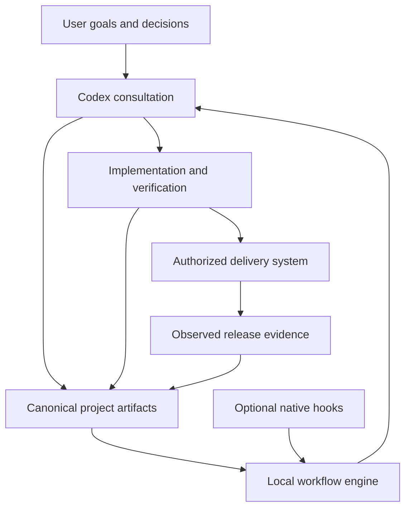

# Workflow architecture

The system has three responsibilities: Codex conducts the consultation and engineering work; a local tool maintains deterministic workflow checks; the project's existing delivery system performs authorized releases. Keeping these responsibilities explicit makes failures diagnosable and avoids treating prose as executable enforcement.

## Runtime boundary

Arrows describe information and work, not a new permission grant. An unresolved consequential decision may pause a phase; already authorized work should continue.

## Put deterministic behavior in code

| Code owns | Codex owns |
| --- | --- |
| Safe installation, path and collision checks | Interpreting existing project authority and resolving conflicting instructions |
| Active-work lookup and source references | Deciding the right scope and route from the user's intent |
| Work schema and phase-transition preconditions | Conducting the adaptive interview and making recommendations |
| Task ID, dependency, coverage and cycle checks | Judging whether requirements, designs and tests are sufficient |
| Review/evidence snapshots and freshness checks | Actually reviewing artifacts, running checks and interpreting observations |
| Eligible-task projection | Implementing the change and choosing meaningful additional verification |
| Bounded hook input and output | Reporting results accurately and deciding when a real blocker needs the user |

A compiled language would not remove the model's judgment obligations. The current standard-library Python implementation keeps the installation small and inspectable. Its CLI and versioned JSON boundary can be retained if distribution or runtime needs later justify another implementation language.

## One authority for each kind of state

Canonical brief and work documents contain facts, answers, requirements and decisions. `tasks.md` contains task completion. `work.json` indexes sources, the selected phase, questions, revision-bound review references and evidence. `.codex/workflow.json` selects the active work directory; it is project-owned data, not a native Codex workflow API.

The engine parses the documented task/check contract, verifies referenced identities and reports contradictions. It does not maintain another mutable task checklist. Reviews and evidence are external observations recorded by a responsible actor. A hash can detect changed files; it cannot authenticate the actor or prove that a stated test ran.

See [the CLI contract](reference/workflow-tooling.md) for exact schema, routes, normalization and limits. Changes to meaningful task scope invalidate relevant evidence; changing a completion checkbox alone must not invalidate the task-plan review it implements.

## Context and consultation

The active context exposes known facts, answered questions, next consequential questions, review state and eligible tasks. Source references let Codex verify the content without rereading the whole repository. The interview starts from available knowledge; it is neither a mandatory form nor a fixed question count. Decisions accumulate in durable artifacts instead of relying on conversation memory.

`AGENTS.md` provides the entry procedure. Optional `SessionStart` and `UserPromptSubmit` hooks refresh context; `Stop` reports record errors without generating an automatic continuation loop. Hook trust, host support and actual loading are separate from fixture correctness. [Native integration](reference/native-hooks.md)

## Greenfield and brownfield

The installer copies a deliberate reusable layer into `.aws-workflow/`, supplies fresh application context where necessary, and appends a bounded instruction block. It excludes framework work/evidence and leaves client configuration and existing active work intact. Brownfield adoption maps established authority before introducing structured work. File preservation is tested by code; semantic compatibility still needs repository assessment. [Adoption contract](reference/bootstrap.md)

## Execution and recovery limits

The engine reports eligible tasks; it does not launch workers, a background daemon, a scheduler, or an AWS deployment. Native Codex handles ordinary turns and tools. Independent agents can work with bounded ownership; the integrating agent verifies their combined candidate.

Resuming a session reloads the durable work records and reevaluates freshness. It does not supply crash-safe orchestration of external side effects. A timed-out deployment remains unknown until the actual system is inspected within authority. Durable worker orchestration needs a separate run/attempt/event protocol and bounded recovery tests. [Future adapter contracts](adapter-contracts.md)
